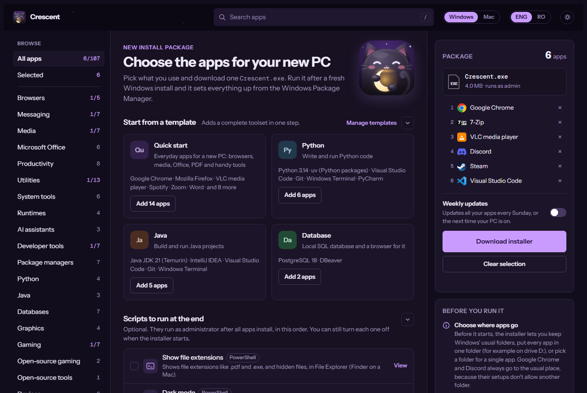
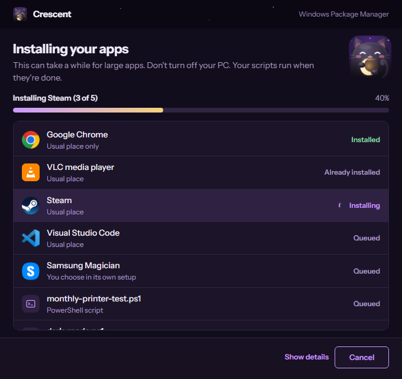

# Crescent

Pick your apps on one web page, download one file, and let it set up a new computer for you.
Crescent works on **Windows** and **Mac**.

**Try it:** https://crescent-installer.pages.dev

## How it works

1. **Pick.** Open the page, tick the apps you want (or start from a template: Quick start, Python,
   Java, Database) and any scripts to run at the end.
2. **Download.** Click **Download installer**. The file is built in your browser; nothing is sent
   to a server.
3. **Run it on the new computer.** It installs every app silently, skips the ones already there,
   runs your scripts and shows a summary. No clicks needed while it works.

| | Windows | Mac |
|---|---|---|
| You get | `Crescent.exe` | `Crescent.zip` with `Crescent.app` |
| Apps come from | winget and the Microsoft Store | Homebrew (set up for you if missing) |
| Needs | Windows 10 or 11, internet | macOS 12 or later, internet |

## First run

Crescent is free and not signed, so the system warns you once:

- **Windows:** SmartScreen says it protected your PC. Click **More info**, then **Run anyway**.
- **Mac:** open the app, choose **Done**, then go to System Settings, Privacy & Security, and click
  **Open Anyway**.

## Try it locally

Clone the repo, then double-click **`setup.cmd`** on Windows, or run `sh setup.sh` on Mac or
Linux. The page opens at http://localhost:8765. You can also just open `web/index.html` in your
browser.

## Status

- **Windows:** tested on real Windows 11.
- **Mac:** built and tested in code, not yet tried on a real Mac.
- Not hosted online yet.

Building, testing and adding apps or scripts: [docs/DEVELOPING.md](docs/DEVELOPING.md).

## Licence

MIT, see [LICENSE](LICENSE). Crescent only installs apps through winget, the Microsoft Store,
Homebrew or the makers' own downloads; each app keeps its own licence.
